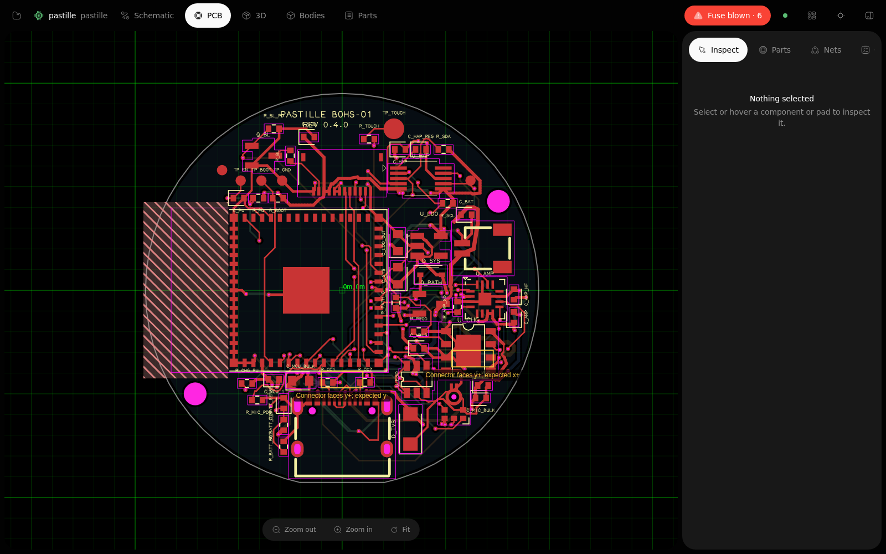
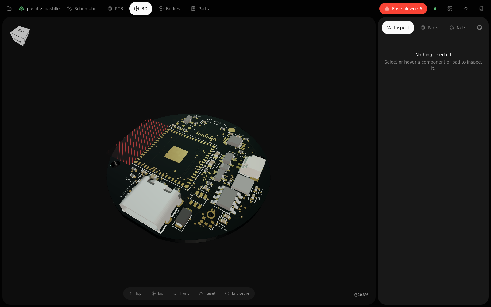
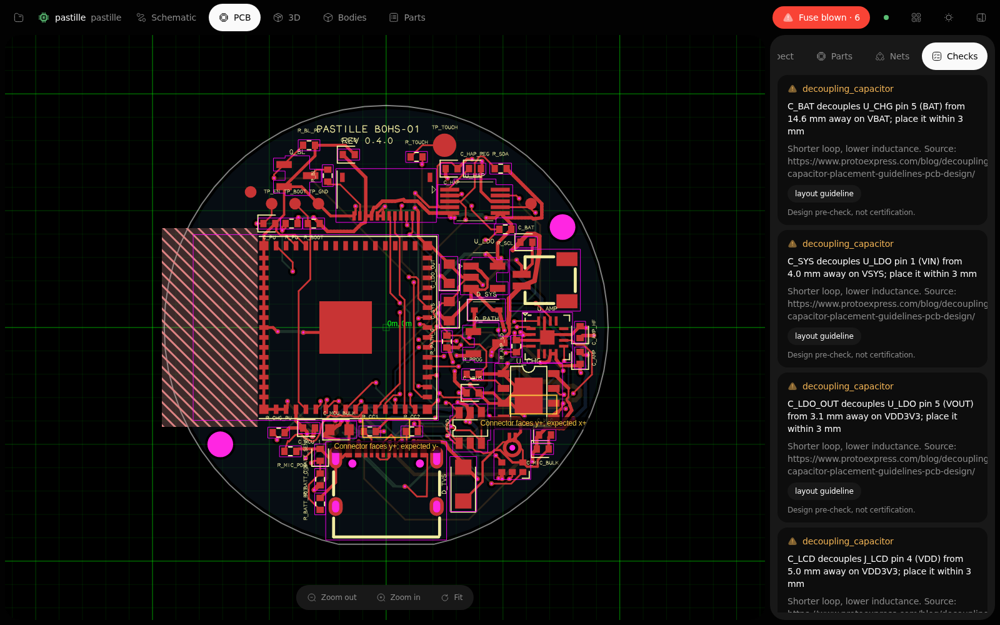
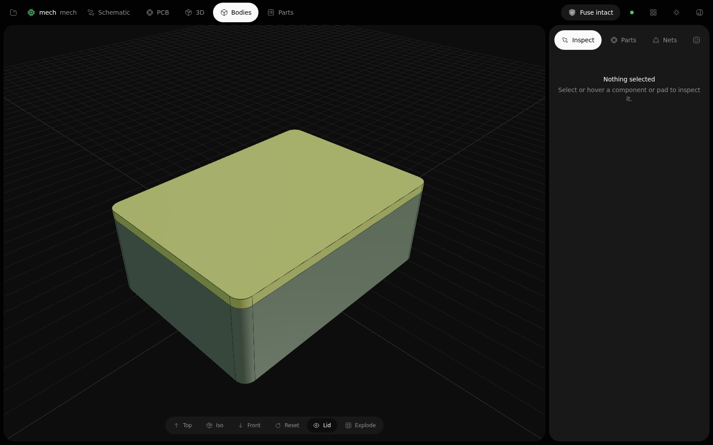
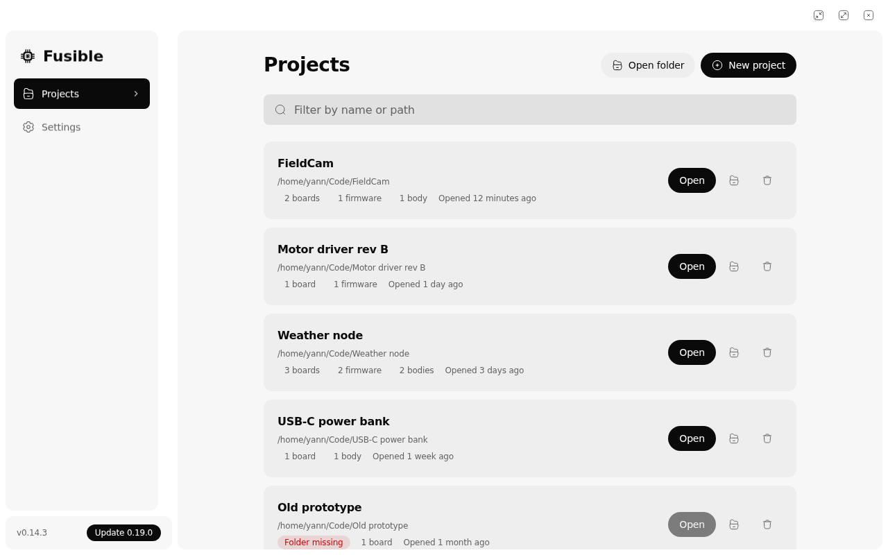
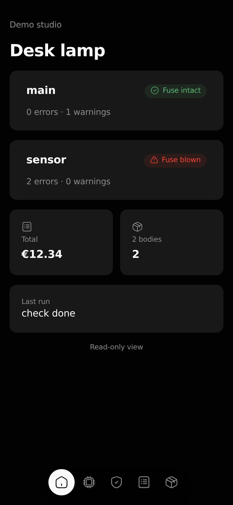
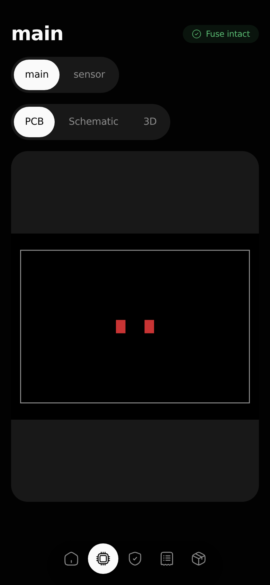

<p align="center">
  
</p>

<h1 align="center">Fusible</h1>

<p align="center">
  <strong>One project for your boards, your firmware, and the case around them.</strong><br>
  Fusible checks the whole design against electrical, physical and mechanical rules.
  When a rule fails, <strong>the fuse blows</strong>: nothing gets exported, generated or flashed.
</p>

<p align="center">
  <a href="https://fusible.facile.studio">Website</a> ·
  <a href="https://fusible.facile.studio/docs">Docs</a> ·
  <a href="https://fusible.facile.studio/download">Download</a> ·
  <a href="https://crates.io/crates/fusible">crates.io</a>
</p>

<p align="center">
  <a href="https://crates.io/crates/fusible"></a>
  <a href="https://github.com/FacileStudio/Fusible/actions/workflows/ci.yml"></a>
  <a href="LICENSE"></a>
</p>

Fusible reads the Circuit JSON that [tscircuit](https://tscircuit.com) produces, checks every
board and part against electrical, physical and mechanical rules, and only then writes
fabrication files, firmware pin bindings and enclosures. It ships as a command line tool, a
browser studio (`fusible studio`), a desktop app, a read-only Android viewer, and an MCP
server that lets agents work on the same project through the same checks.



<table>
  <tr>
    <td width="50%"></td>
    <td width="50%"></td>
  </tr>
  <tr>
    <td width="50%"></td>
    <td width="50%"></td>
  </tr>
</table>

<p align="center">
  
  
</p>

## What you get

| Piece | What it does |
|---|---|
| Linter | Nets, shorts, clearance, decoupling, pin muxing, routing, cabled connectors. |
| Physics rules | Trace current (IPC-2152), voltage clearance (IPC-2221B), fab capability (JLCPCB), each citing its source. |
| Studio | Live PCB, schematic, 3D, parts, firmware pins, bodies and checks in the browser. |
| Mechanical | Enclosure generation and parts written in TypeScript on OpenCascade, with materials and processes. |
| Firmware | Typed Rust pin bindings (`pins.rs`) for STM32, RP2040, RP2350A, RP2350B, ESP32-S3 and ESP32-C3, plus `pins.h` and an experimental Zephyr overlay. |
| Fabrication | Gerbers with copper pours, drills, BOM, pick and place, KiCad, STEP, GLB, SVG, PDF, then a release gate. |
| BOM | Prices, picks, material mass and print cost. |
| Agents | `fusible mcp` serves checks and fuse-gated edits to Bulle, Claude Code, Codex and others. |
| Apps | A signed-update desktop app (Windows, macOS, Linux) and a read-only Android viewer paired by QR code. |
| Suite | Opus tasks from blown fuses, Nuage sharing of fab files, a `SYNC` panel sharing the project through git. |
| KiCad | The studio watches your `.kicad_pcb` and writes moved parts back into your TSX. |

## Install

```sh
cargo install fusible
```

Linting Circuit JSON, Gerbers and SVG needs nothing else. To compile `.tsx` boards or export
STEP, install tscircuit and check the toolchain:

```sh
bun add -g tscircuit
fusible doctor            # reports bun, node, tsci, flash tools and firmware toolchains
fusible doctor --install  # installs what is missing
```

The desktop app and the Android app are attached to each
[GitHub release](https://github.com/FacileStudio/Fusible/releases/latest). Installers are not
code-signed with Apple or Microsoft certificates, so your OS will warn you; in-app updates are
verified against Fusible's own signing key.

## Quick start

```sh
fusible new sensor-node --template esp32-s3
cd sensor-node
fusible check
fusible studio
```

`new` writes a board with `pinAttributes` on its MCU and regulator, a firmware crate, a
generated enclosure and a `fusible.yml`. Templates are `esp32-s3`, `stm32g4`, `rp2040` and
`blank`. Each ships a pre-built Circuit JSON, so `fusible check` passes before any install.

The firmware is real embedded Rust that blinks the board LED through the generated bindings:
Embassy (`embassy-stm32`, `embassy-rp`) for `stm32g4` and `rp2040`, `esp-hal` with
`esp-rtos` for `esp32-s3`. `fusible build` compiles it and `fusible flash` flashes it with
`probe-rs` or `espflash`. rustup fetches the Cortex-M target on the first build; the ESP32-S3
needs the `esp` toolchain from [espup](https://github.com/esp-rs/espup). `fusible doctor`
says what is missing.
Upgrading a 1.x project? Run `fusible migrate`; see [docs/migrate-2.0.md](docs/migrate-2.0.md).

To add Fusible to an existing folder, `fusible init --name sensor-node` writes a `fusible.yml`:

```yaml
name: sensor-node

boards:
  main:
    entry: hardware/index.tsx
    mcu: stm32g431

firmware:
  app:
    board: main
    path: firmware
    framework: embassy
    pins_rs: firmware/src/pins.rs
    build_cmd: cargo build
```

`fusible init --currency USD` also writes a `bom.yml`.

## The project file

A project has three kinds of named things. Names are unique across all three, so any command
takes one as its target.

```yaml
name: rover

boards:
  main:   { entry: boards/main/index.tsx, mcu: esp32-s3 }
  sensor: { entry: boards/sensor/index.tsx, mcu: rp2040, kicad: boards/sensor/sensor.kicad_pcb }

firmware:
  main-fw:   { board: main, path: firmware/main, pins_rs: firmware/main/src/pins.rs }
  sensor-fw: { board: sensor, path: firmware/sensor, pins_rs: firmware/sensor/src/pins.rs }

bodies:
  case: { source: bodies/case.step }
  knob: { source: bodies/knob.step, build: python bodies/knob.py }
  lid:  { generate: enclosure, board: sensor }

links:
  cable:
    from: main.J2
    to: sensor.J1
    wires:
      - { a: 1, b: 1, net: GND }
      - { a: 2, b: 3, nets: [TX, RX] }
```

- `fusible check` checks every board and every link; `fusible check sensor` checks one board.
- `fusible build sensor-fw` checks the `sensor` board, writes its pin bindings, then builds that firmware.
- `fusible export main --preset fab` writes into `dist/main/fab/`. With several boards, `export` and `studio` need a name.
- A firmware or generated body names its `board:` when the project has several (`around:` is an alias). The old single-board form (`hardware:`, `mcu: { chip }`, one `firmware:`, `mechanical:`) still loads.

### Links between boards

A link says a connector of one board is cabled to a connector of another. Each wire joins a pin
`a` of `from` to a pin `b` of `to`; a pin is a number (`1`) or a name (`TX`).

- No `net`: both ends must carry the same net name.
- `net: GND`: both ends must carry `GND`.
- `nets: [TX, RX]`: the first end must carry `TX`, the second `RX`. Use it for crossed wires.

The `harness_mismatch` rule blows the fuse when a connector or pin does not exist, a pin is
wired to nothing, or the nets do not match. It runs in `check` and `build`, once every board
passes.

## Commands

The flag-by-flag reference lives in [docs/usage.md](docs/usage.md): the studio panels
(`RUNS`, `PINS`, `BODIES`, `PARTS & COSTS`, `SYNC`), the KiCad watch, `body eject` and
`body kit`, `assembly`, `route`, `bom`, `release`, phone pairing and the Opus/Nuage hooks.

```sh
fusible new demo --template rp2040  # a project from a template
fusible check                       # every board of fusible.yml, then every link
fusible check sensor --mcu stm32g431 # one board, pin muxing checked against the silicon
fusible --input circuit.json        # Circuit JSON directly
fusible studio                      # the browser studio, on port 3020
fusible build main-fw               # check, write pins.rs, build that firmware
fusible rules                       # every rule with its category and level
fusible explain trace_current       # one rule: standard, source, level, how to waive it
fusible migrate --check             # does fusible.yml need the 2.0 rewrite?
fusible export --preset fab         # gerbers + circuit.json, only while the fuse is intact
fusible body                        # generated enclosure or authored body into dist/bodies/
fusible assembly                    # boards and bodies as one model
fusible route                       # multi-layer A* autorouter
fusible bom                         # parts, prices, print mass
fusible release                     # fab files, BOM, pick and place, RELEASE.txt
fusible mcp                         # MCP server for agents
fusible flash app                   # fuse-gated, then probe-rs or espflash
fusible bringup main                # dist/bringup.md: rails, test points, straps
```

```
the fuse blew: 1 electrical violation(s)
[unconnected_net] net "I2C_SDA" has only 1 connection(s) (minimum 2): it is floating
help: every net must connect at least two pads/ports: complete the routing in tscircuit
```

TSX compilation stops after 120 seconds (`FUSIBLE_BUILD_TIMEOUT_SECS`) and results are cached
in `.fusible/cache` (`FUSIBLE_NO_CACHE=1` bypasses it). `check` writes no file; `fusible build`
or `check --write-bindings` writes `pins.rs`. `--json` prints the verdict with every
diagnostic, links, assembly and waivers, and exit codes do not change. A rule that cannot prove a net is connected reports
it: silence is never the default.

## Rules

Every rule runs in the fuse. Errors blow it. Warnings and infos print. Rules that need your
numbers stay off until you declare them in `fusible.yml`. `fusible rules` lists every rule with
its category and level, `fusible explain <rule>` describes one, and [docs/rules/](docs/rules/README.md)
holds one generated page per rule.

| Rule | Checks | Source |
|---|---|---|
| `trace_current` | Temperature rise of the narrowest trace of a net that declares `current`. | IPC-2152 (Brooks and Adam fit, as in KiCad): https://docs.kicad.org/doxygen/tracks__width__versus__current__formula_8h.html |
| `voltage_clearance` | Copper spacing between nets for their voltage difference, class B1, B2 or B4. | IPC-2221B Table 6-1 |
| `fab_profile` | Trace width and spacing, drill, via pad, annular ring, via to via, board size for `jlcpcb-2l`, `jlcpcb-4l` or your own limits. | https://jlcpcb.com/capabilities/pcb-capabilities |
| `trace_clearance` | Copper clearance between different nets, 0.15 mm unless a fab profile is set. | |
| `decoupling_capacitor` | Every IC supply pin has a bypass capacitor, within 3 mm (warning). | https://www.protoexpress.com/blog/decoupling-capacitor-placement-guidelines-pcb-design/ |
| `unrouted` | A board with nets but no routed trace, or a `source_trace` with no `pcb_trace`. | |
| `footprint_overlap`, `courtyard_overlap`, `placement`, `off_board`, `trace_error`, `trace_missing`, `port_not_connected`, `via_clearance`, `pad_trace_clearance`, `via_trace_clearance`, `pad_pad_clearance`, `autorouting`, `connector_accessibility` | Errors tscircuit recorded in the Circuit JSON, one id per kind. Any other `*_error` blows the fuse as `upstream_error`. | tscircuit |
| `upstream_warning`, `unnamed_trace` | Warnings tscircuit recorded, one line per kind. `unnamed_trace` is info level. | tscircuit |
| `unconnected_net`, `ghost_net`, `shorted_nets`, `malformed_element`, `dangling_reference` | Netlist integrity. | |
| `pin_mux` | Pin muxing against the silicon of the target MCU. | |
| `qfn_footprint_span` | A qfn footprint that gives only a copper span (warning). | |
| `schematic_scale` | A schematic too large for one sheet. | |
| `harness_mismatch` | Cabled connectors that do not match. | |
| `body_interference`, `hole_misaligned`, `connector_blocked` | Boards against bodies in an assembly. | |
| `mech.*` | Wall thickness, bosses, port and component clearance, vents, standoff height and draft, by process. | see [Mechanical parts](docs/usage.md#mechanical-parts) |

Declare the numbers a rule needs:

```yaml
nets:
  VBUS: { voltage: 5, current: 2, max_rise: 10 }   # trace_current, voltage_clearance
  MAINS_L: { voltage: 230 }
fab: jlcpcb-2l                # or jlcpcb-4l, or { min_trace: 0.15, min_space: 0.15, ... }
clearance_class: B2           # B1 internal, B2 external uncoated (default), B4 coated
copper: { outer_oz: 1, inner_oz: 0.5 }
```

Set a rule's level, or accept one case with a reasoned waiver:

```yaml
rules:
  decoupling_capacitor: warning   # off | info | warning | error
waivers:
  - rule: decoupling_capacitor
    match: U3.VDD                 # element id or REFDES.PIN
    reason: bulk capacitor C12 is shared, checked on rev A
    until: 2027-03-01             # optional
```

A waived diagnostic moves to the report's `waived` list; it never disappears. Netlist rules
cannot be lowered or waived. An unknown rule id is exit 2.

These are design pre-checks, not certifications: Fusible does not check creepage under IEC
62368-1 yet, and a product with a safety rating still needs a lab. Fab profiles carry a source
URL and the date they were checked.

## Agents

```sh
fusible mcp --print-config bulle     # or claude, or codex
```

The server exposes checks, rule explanations, the BOM, firmware pins and fuse-gated edits:
`edit_board`, `apply_fix` for a diagnostic's `set_prop` fix, and `waive` for a reasoned waiver.
Every edit returns the diff and the new verdict, and nothing is committed for you. See
[docs/usage.md](docs/usage.md#agents) for the YAML snippet and
[docs/agents.md](docs/agents.md) for the tool list and write-safety rules.

## Exit codes

| Code | Meaning |
|---|---|
| `0` | Fuse intact. The command succeeded. |
| `1` | Fuse blown. A rule failed and generation is blocked. |
| `2` | Tool error. Unreadable input, missing runner, or bad arguments. |

CI can tell a bad design (1) from a broken setup (2).

## CI

The repository is also a GitHub Action. It installs a release binary, sets up bun, runs
`fusible check`, and fails the job when the fuse blows:

```yaml
- uses: actions/checkout@v7
- id: fuse
  uses: FacileStudio/Fusible@v1
  with:
    target: ""        # optional board name or file; empty checks every board
    version: latest   # or a version such as 1.0.0
```

Other inputs: `working-directory` (default `.`) and `install-deps` (default `true`). The `fuse`
output is `intact`, `blown` or `error`, from exit codes 0, 1 and 2.

## Documentation

| Doc | What's in it |
|---|---|
| [usage](docs/usage.md) | Every command, flag and behaviour |
| [agents](docs/agents.md) | Driving Fusible from an AI agent |
| [rules](docs/rules/README.md) | One page per rule, generated from `fusible rules --json` |
| [migrate to 2.0](docs/migrate-2.0.md) | Rule renames, the version 2 report, `pins.rs`, `fusible migrate` |
| [mechanical](docs/v1/E-mechanical.md) | Materials, processes and the limits behind `mech.*` |

## Layout of the source

```
src/
├── cli.rs, dispatch.rs, main.rs   # commands and exit codes
├── commands/                      # check, build, export, body, bom, release, mcp, new, explain, migrate, doctor
├── check/                         # one check pipeline: levels, waivers, links, assembly -> Report
├── project/                       # the project loaded once per command
├── config/                        # fusible.yml: boards, firmware, bodies, links, rules, waivers
├── parser/, netlist/, linter/     # pure Rust: Circuit JSON, net graph, rules
├── silicon/, codegen/             # pin muxing databases and pins.rs
├── gerber/, svg/, router/, kicad/ # fabrication, rendering, routing, KiCad sync
├── dev/                           # studio server (tiny_http, SSE, git, KiCad watch, pairing)
├── tscircuit/                     # runner discovery and process control
└── assets/                        # embedded studio
studio/                            # Svelte studio, built into src/assets/studio.bundle.js
desktop/                           # Tauri shell and its Svelte UI
mobile/                            # Capacitor Android viewer
site/                              # fusible.facile.studio
scripts/                           # screenshots, rules-doc.ts (docs/rules/)
```

The parser, netlist and rules have no C dependencies. tscircuit, bun and `occt-wasm` are used
only for TSX, STEP and bodies.

## Development

```sh
cargo fmt --all -- --check
cargo clippy --all-targets -- -D warnings
cargo test --locked
filet check .
```

Rebuild the studio bundle with `cd studio && bun run build`. See [ROADMAP.md](ROADMAP.md) for
what is next and [CHANGELOG.md](CHANGELOG.md) for what changed.

## License

Fusible is licensed under the GNU General Public License v3.0 only ([GPL-3.0-only](LICENSE)).